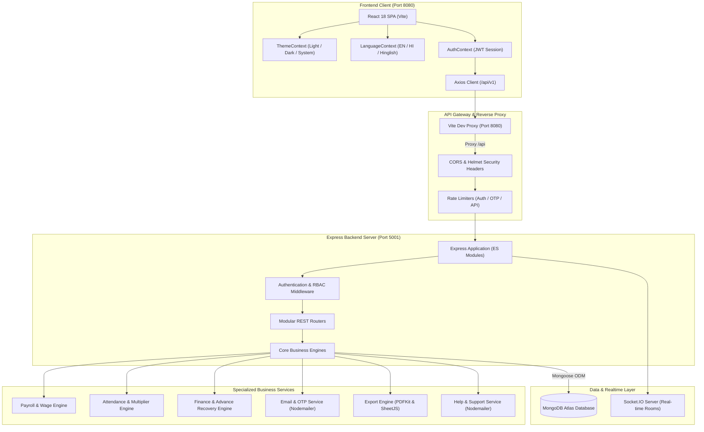
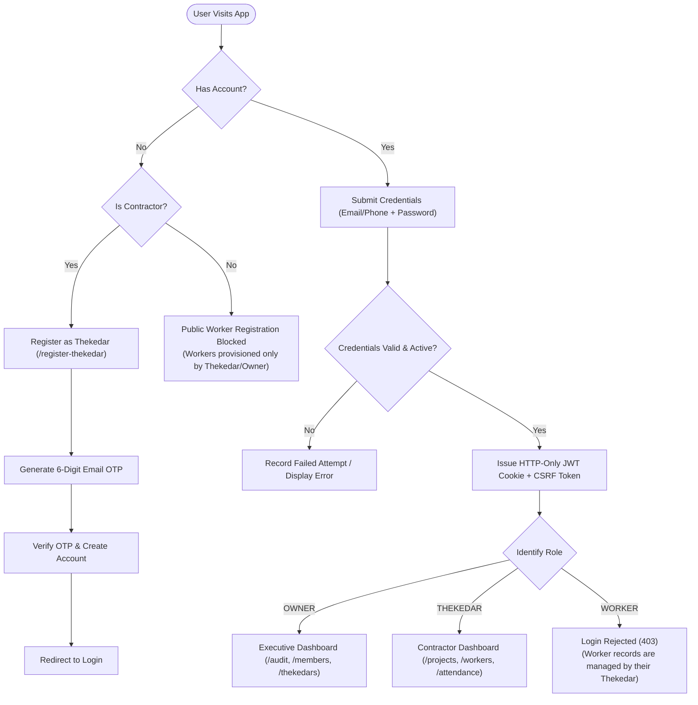
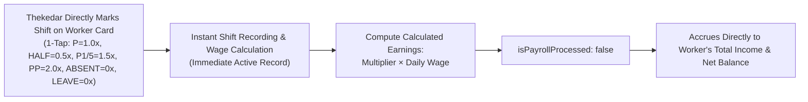
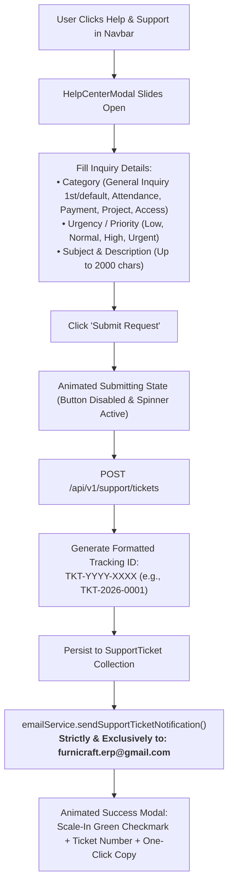

# FurniCraft — Modern Furniture Workforce & Financial Management ERP

[](https://furnicraft-erp.onrender.com)

[](https://nodejs.org/)
[](https://expressjs.com/)
[](https://react.dev/)
[](https://vitejs.dev/)
[](https://tailwindcss.com/)
[](https://www.mongodb.com/)
[](https://socket.io/)
[](https://jwt.io/)
[](https://vitest.dev/)
[](https://furnicraft-erp.onrender.com)
[](LICENSE)

> 🚀 **Live Production Application**: [**https://furnicraft-erp.onrender.com**](https://furnicraft-erp.onrender.com)

**FurniCraft** is an enterprise-grade MERN-stack workforce, attendance, payroll, and workshop financial operations platform engineered exclusively for modern interior furniture manufacturing, cabinetry workshops, and modular installation businesses.

The application natively supports specialized interior carpentry craft scopes:
- **Modular Kitchens** (Base & wall carcasses, acrylic/PU finishes, tandem boxes, servo-drive drawers)
- **Sliding & Walk-in Wardrobes** (Top-hung tracks, aluminum profiles, soft-close dampers, sensor LED channels)
- **TV Units & Acoustic Paneling** (Fluted panels, veneer/laminate finishes, concealed cable conduits)
- **Workstations & Office Desking** (Raceway wiring, modular partitions, pedestal storage)
- **Beds, Headboards & Dressing Units** (Hydraulic storage beds, upholstered fluting, dresser mirrors)
- **Workshop Operations** (Edge-banding, panel-saw cutting, PU polishing, site assembly & hardware fittings)

---

## 1. System Architecture

The following diagram illustrates the end-to-end system architecture of FurniCraft, separating client delivery, security middleware, API services, and data layers:



---

## 2. Core Business Workflows & Flowcharts

### A. Authentication & Role-Based Access Control (RBAC)
FurniCraft enforces a strict 3-role governance model with protected workforce provisioning:



---

### B. Direct Shopfloor Shift Attendance & Wage Multiplier Lifecycle
All craftsman shifts and attendance are managed **exclusively by the supervising Thekedar** with single-tap direct logging. Workers have no system accounts, and shifts are immediately recorded and active without any multi-stage approval queues or pending reviews:

$$\text{Calculated Earnings} = \text{Wage Multiplier} \times \text{Default Daily Wage}$$



---

### C. Financial Balance & "Pay Net Wages" Settlement Engine
All financial balances strictly obey the golden accounting formula:

$$\text{Net Balance} = \text{Total Income (Earned Shift Wages)} - \text{Outstanding Advance Balance}$$

When paying net wages, contractors can deduct outstanding advances directly from both base earnings and bonuses:


---

### D. Help & Support Center Ticket & Exclusive Email Routing Lifecycle
Contractors and Owners can submit inquiries, site assistance queries, or technical issue reports directly through the built-in Help & Support modal in the navigation bar:



---

## 3. Technology Stack

### Mobile-First & Responsive Desktop Interface

FurniCraft is designed primarily for contractors on their phones, while providing a powerful multi-column workspace on desktop:

- **Sticky Desktop Navigation**: Navbar and Sidebar remain fixed (`sticky top-0`) on desktop view, keeping brand identity, theme/language toggles, Help & Support access, and section navigation permanently accessible while workspace content scrolls.
- **Bottom tab bar** (below 768px): the four most-used screens per role plus a **More** sheet for the rest. The sidebar is shown from 768px up.
- **Bottom sheets**: every dialog (`Modal.jsx`) slides up from the bottom on phones, locks background scroll, and closes on backdrop tap or ESC.
- **Single-Line Filter Pills**: Project status tabs and transaction categories stay strictly on a single line on all devices (`overflow-x-auto no-scrollbar touch-pan-x whitespace-nowrap`) with touch-friendly horizontal swipe.
- **Compact Mobile Transaction Ledger**: On mobile view, matching transaction records display in a 3-card scrollable viewport (`max-h-[352px] overflow-y-auto`) so the official voucher card below remains instantly visible without excessive scrolling. On desktop, it expands to a dual-column ledger with `lg:max-h-[700px]`.
- **4-Item Dashboard Recency Capping**: Dashboard cards (`Recent payments & advances` and `Active projects`) show at most the 4 latest records, with an `All ↗` link directing to full records.
- **Stacked tables**: any table inside `.overflow-x-auto` turns into labelled cards below 640px; labels are copied from the `<th>` headers automatically (`AppLayout.jsx` + `index.css`), so new tables get this for free.
- **Touch & readability**: 44px primary buttons, 36px minimum for pills/selects, 16px inputs (no iOS zoom), no 9-10px text on phones, pinch-zoom allowed.
- **Smooth motion**: route fade-in, sheet slide-up and press feedback, all disabled under `prefers-reduced-motion`.
- **Installable**: `manifest.webmanifest` + safe-area insets (`viewport-fit=cover`) so "Add to Home Screen" opens it full-screen like an app.

### Comprehensive Technology Stack

FurniCraft is built on a modern, high-performance technology stack spanning frontend SPA delivery, reactive real-time communications, secure RESTful micro-services, and enterprise cloud data layers:

#### 1. Frontend Technologies
| Technology | Version | Purpose |
| :--- | :--- | :--- |
| **React** | `v18.3.1` | Declarative component UI library for SPA rendering |
| **Vite** | `v5.4.21` | High-speed frontend build tool, ES module bundler & dev server |
| **Tailwind CSS** | `v3.4.13` | Utility-first CSS framework with custom slatewood palette & dark mode |
| **React Router** | `v6.26.2` | Client-side routing, protected auth guards, and nested layouts |
| **Lucide React** | `v0.446.0` | Comprehensive modern vector SVG icon library |
| **FontAwesome** | `v6.5.2` | Specialized brand and user vector icons |
| **Axios** | `v1.7.7` | Promise-based HTTP client with language headers & response interceptors |
| **Socket.IO Client** | `v4.8.0` | Real-time WebSocket room subscriptions and live updates |
| **Recharts** | `v2.12.7` | Responsive composable charts for real-time workshop analytics |
| **Vitest & RTL** | `v1.6.1` | Unit and integration testing with JSDOM environment |

#### 2. Backend & API Technologies
| Technology | Version | Purpose |
| :--- | :--- | :--- |
| **Node.js** | `v18+ / v20 / v24` | High-performance asynchronous JavaScript server runtime (ES Modules) |
| **Express.js** | `v4.21.0` | RESTful routing, custom middleware pipeline, and static SPA serving |
| **Zod** | `v3.23.8` | Strict runtime request schema validation |
| **JSON Web Token (JWT)** | `v9.0.2` | Stateless, tamper-proof session tokens stored in HTTP-only cookies |
| **bcryptjs** | `v2.4.3` | Cryptographic password hashing with 10 salt rounds |
| **Helmet** | `v7.1.0` | Security headers (CSP, HSTS, X-Content-Type-Options) |
| **express-rate-limit** | `v7.4.0` | IP-based brute-force protection on authentication and support endpoints |
| **cookie-parser** | `v1.4.6` | Parsing HTTP-only session cookies |
| **cors** | `v2.8.5` | Cross-Origin Resource Sharing control and origin validation |
| **compression** | `v1.7.4` | Gzip response compression middleware for fast mobile delivery |

#### 3. Database & Real-Time Communications
| Technology | Version | Purpose |
| :--- | :--- | :--- |
| **MongoDB Atlas** | `v7+ Cloud` | Scalable cloud document database for ledgers, attendance, and projects |
| **Mongoose** | `v8.6.3` | Schema definition, model validation, and aggregation pipelines |
| **Socket.IO Server** | `v4.8.0` | Bi-directional WebSocket communication for real-time room alerts |
| **Nodemailer** | `v6.9.15` | Transactional email delivery for OTP password reset and Help Center tickets |
| **Gmail SMTP** | App Passwords | Reliable transactional dispatch engine strictly routing support tickets |

#### 4. Document Generation & Localization
| Technology | Version | Purpose |
| :--- | :--- | :--- |
| **PDFKit** | `v0.15.0` | Server-side programmatic vector PDF generation for official vouchers |
| **SheetJS (XLSX)** | `v0.18.5` | Programmatic export of tabular attendance and financial ledger sheets |
| **Google Noto Sans** | SIL OFL | Bundled open-source typography rendering Indian Rupee (`₹`) symbols cleanly |
| **Tri-Lingual Localization** | Custom Engine | Native English, Hindi (हिंदी), and Hinglish dictionary support |

#### 5. Cloud Infrastructure & Hosting
| Technology | Version | Purpose |
| :--- | :--- | :--- |
| **Render** | Cloud Platform | Single Unified Web Service running Express API & built React client |
| **Render Blueprint (`render.yaml`)** | IaC | Automated zero-downtime continuous deployment on git push |

---

## 4. Complete Project File Structure

```
FurniCraft/
├── package.json                         # Root package workspace scripts
├── .gitignore                           # Git exclusions (node_modules, .env, dist, logs)
├── README.md                            # Comprehensive system documentation
│
├── client/                              # Frontend React Single Page Application (Port 8080)
│   ├── index.html                       # HTML entry point with early theme bootstrap
│   ├── vite.config.js                   # Vite configuration (Port 8080, /api proxy to 5001)
│   ├── tailwind.config.js               # Tailwind CSS configuration with darkMode: 'class'
│   ├── postcss.config.js                # PostCSS autoprefixer plugins
│   ├── package.json                     # Client dependencies & scripts
│   ├── public/                          # Static brand icons & favicon assets
│   │   ├── furnicraft-logo.png          # Signature FC wood/blue monogram logo
│   │   ├── furnicraft-icon.svg          # Vector furniture monogram mark
│   │   └── favicon.ico                  # Browser tab icon
│   └── src/
│       ├── main.jsx                     # Application bootstrap & DOM root mounting
│       ├── App.jsx                      # Route definitions, ProtectedRoute guards & Layout
│       ├── index.css                    # Tailwind directives, custom scrollbars, dark theme rules
│       ├── api/
│       │   └── client.js                # Central Axios instance with credentials & interceptors
│       ├── context/
│       │   ├── AuthContext.jsx          # User login state, role helpers & logout handler
│       │   ├── LanguageContext.jsx      # Language state (en, hi, hinglish) & t() translation helper
│       │   └── ThemeContext.jsx         # Theme state (light, dark, system) & DOM class toggler
│       ├── locales/
│       │   └── translations.js          # Tri-lingual localization dictionaries (EN / HI / HINGLISH)
│       ├── components/
│       │   ├── common/                  # Reusable UI component library
│       │   │   ├── Badge.jsx            # Status indicators (Active, Suspended, Shift Multipliers)
│       │   │   ├── BrandLogo.jsx        # Responsive official FurniCraft emblem
│       │   │   ├── Button.jsx           # Accessible button with loading spinners & variants
│       │   │   ├── Card.jsx             # Themed content card container
│       │   │   ├── ErrorBoundary.jsx    # Graceful React crash fallback container
│       │   │   ├── HelpCenterModal.jsx  # Interactive Help & Support ticket submission with animated success modal
│       │   │   ├── LanguageSelector.jsx # Pill & button variants for language switching
│       │   │   ├── LoadError.jsx        # User-friendly failed network request retry card
│       │   │   ├── Modal.jsx            # Bottom sheet on phones, centered dialog on desktop (ESC, scroll lock)
│       │   │   ├── PageHeader.jsx       # Standardized page title, subtitle & action controls
│       │   │   └── ThemeSelector.jsx    # Light / Dark / System mode switch controls
│       │   ├── layout/                  # Shell layout components
│       │   │   ├── AppLayout.jsx        # Shell: Sticky Navbar + Sticky Sidebar/BottomNav + animated page outlet, phone table stacking
│       │   │   ├── Navbar.jsx           # Sticky top bar with BrandLogo, Help & Support trigger & profile (theme, language, sign out)
│       │   │   ├── Sidebar.jsx          # Sticky desktop sidebar (sticky top-0) + shared role-filtered nav links (useNavLinks)
│       │   │   └── BottomNav.jsx        # Phone bottom tab bar with "More" sheet
│       │   └── attendance/
│       │       └── AttendanceCalendar.jsx # Interactive monthly grid with multiplier badges
│       ├── pages/                       # Dedicated application views
│       │   ├── LoginPage.jsx            # Sign in, demo credentials & Email OTP reset modal
│       │   ├── ThekedarRegisterPage.jsx # Public self-registration for contractors
│       │   ├── OwnerDashboard.jsx       # Owner overview: net payable, unpaid wages, 4-item recent payments & activity cards with All links
│       │   ├── ThekedarDashboard.jsx    # Contractor operations: 4-item active projects & recent transactions cards with All links
│       │   ├── ProjectsPage.jsx         # Furniture project list, single-line status filters across all devices, milestones & creation
│       │   ├── ProjectDetailPage.jsx   # Project money received & site summary
│       │   ├── WorkersPage.jsx          # Worker cards + tap-to-open sheet: Pay Net Wages, Give Advance, Edit, and attendance statement PDF
│       │   ├── ExpensesPage.jsx         # Project money received & site material expenses
│       │   ├── TransactionSearchPage.jsx# Transaction History: 3-card mobile viewport with vertical scroll, 2-column desktop voucher inspection
│       │   ├── DisputesPage.jsx         # Grievances & transparent issue resolution
│       │   ├── AuditLogsPage.jsx        # Tamper-evident immutable system security logs
│       │   ├── MembersOverviewPage.jsx  # Organization roster & active workforce visits
│       │   └── ThekedarsPage.jsx        # Owner contractor oversight & account suspension
│       └── tests/                       # Vitest client test suites
│           ├── setup.js                 # JSDOM matchMedia mock & test configuration
│           ├── ThemeMode.test.jsx       # Dark/Light/System theme toggler tests
│           ├── LoginPage.test.jsx       # Authentication UI validation tests
│           ├── AttendanceCalendar.test.jsx # Shift multiplier rendering tests
│           ├── apiErrors.test.js        # Offline, timeout, and translated API client errors
│           └── AllPagesRender.test.jsx  # Comprehensive zero-blank-screen verification
│
└── server/                              # Backend Node.js / Express REST API (Port 5001)
    ├── package.json                     # Server scripts, dependencies & Vitest config
    ├── vitest.config.js                 # Server test runner configuration
    ├── tests/                           # Vitest server integration test suites
    │   ├── setup.js                     # Test database connection setup & teardown
    │   ├── auth.test.js                 # Authentication & token verification tests
    │   ├── auth_rules.test.js           # Password reset OTP lifecycle tests
    │   ├── authorization.test.js        # Strict RBAC & IDOR prevention tests
    │   ├── attendance.test.js           # Multiplier calculation & duplicate shift tests
    │   ├── finance.test.js              # Advance recovery & ledger transaction tests
    │   ├── errorHandler.test.js         # Centralized error formatter validation
    │   └── support.test.js              # Help & Support ticket validation & exclusive email destination tests
    └── src/
        ├── server.js                    # HTTP server startup & Socket.IO initialization
        ├── app.js                       # Express app configuration, middleware & route mounting
        ├── config/
        │   ├── constants.js             # Enums: ROLES, SHIFTS, STATUS, CATEGORIES, CODES
        │   ├── db.js                    # Resilient MongoDB connection with DNS fallback
        │   └── env.js                   # Type-safe environment variable validation
        ├── middleware/
        │   ├── authMiddleware.js        # JWT token verification & role enforcement guards
        │   ├── errorHandler.js          # Centralized error formatter (CastError, ValidationError)
        │   ├── rateLimiter.js           # Sensitive endpoint brute-force protection
        │   ├── resourceAuthMiddleware.js# Resource-level access authorization (anti-IDOR)
        │   └── validationMiddleware.js  # Zod schema request body/query validation
        ├── models/                      # Mongoose Schema Definitions
        │   ├── index.js                 # Central model registry
        │   ├── User.js                  # User credentials, role, status & failed login tracking
        │   ├── WorkerProfile.js         # Daily wage, advance balance, skills, bank details
        │   ├── WageAgreement.js         # Historical & contractual daily wage agreements
        │   ├── Attendance.js            # Daily shifts, multiplier (1.0x, 0.5x, 1.5x, 2.0x), earnings calculation
        │   ├── AttendanceRuleVersion.js # Audit versioning for shift multiplier rules
        │   ├── Project.js               # Furniture project details, scope & deadlines
        │   ├── ProjectAssignment.js     # Legacy worker-to-project records (read-only; wage overrides)
        │   ├── FinancialTransaction.js  # Immutable double-entry financial ledger records
        │   ├── AdvanceRequest.js        # Craftsman cash advance records & tracking
        │   ├── Payroll.js               # Finalized monthly payroll sheets
        │   ├── PayrollAdjustment.js     # Post-finalization debit/credit adjustments
        │   ├── ProjectExpense.js        # Hardware, laminates, fittings & site expenses
        │   ├── ProjectMoneyReceived.js  # Client milestone payment receipts
        │   ├── SupportTicket.js         # Help & support inquiries, ticket codes & dispatch status
        │   ├── Dispute.js               # Worker grievances & resolution status
        │   ├── Notification.js          # In-app real-time notification alerts
        │   ├── OtpRecord.js             # Hashed 6-digit OTPs with expiration timestamps
        │   ├── RevokedToken.js          # Blacklisted JWTs upon logout
        │   └── AuditLog.js              # Tamper-evident security and activity audit trail
        ├── routes/                      # REST API Endpoint Routers
        │   ├── authRoutes.js            # /api/v1/auth (Login, Logout, Me, OTP Reset)
        │   ├── userRoutes.js            # /api/v1/users (Workers, Thekedars, Status changes)
        │   ├── projectRoutes.js         # /api/v1/projects (CRUD, money received)
        │   ├── attendanceRoutes.js      # /api/v1/attendance (Mark, Update, Calendar)
        │   ├── payrollRoutes.js         # /api/v1/payroll (Preview, Finalize, Lock, Adjust)
        │   ├── financeRoutes.js         # /api/v1/finance (Ledger, Advances, Give Advance, Pay Net Wages)
        │   ├── expenseRoutes.js         # /api/v1/expenses (Client payments & project costs)
        │   ├── reportRoutes.js          # /api/v1/reports (PDF vouchers, Excel attendance)
        │   ├── supportRoutes.js         # /api/v1/support (Help & Support ticket creation & dispatch)
        │   ├── systemRoutes.js          # /api/v1/system (System health & diagnostics)
        │   ├── disputeRoutes.js         # /api/v1/disputes (Filing & administrative resolution)
        │   └── auditRoutes.js           # /api/v1/audit (Owner-only security audit log queries)
        ├── services/                    # Encapsulated Business Logic Services
        │   ├── authService.js           # Authentication, session tokens & OTP lifecycle
        │   ├── attendanceService.js     # Shift evaluation, earnings aggregation, calendar data
        │   ├── financeService.js        # Advance disbursements, net pay computation, ledger
        │   ├── payrollEngineService.js  # Monthly salary computation & immutable locking
        │   ├── projectService.js        # Furniture project lifecycle & money received
        │   ├── reportService.js         # Tabular data preparation for exports
        │   ├── exportService.js         # PDFKit payslip documents & Excel workbook formatting
        │   ├── emailService.js          # Transactional email dispatcher with Nodemailer
        │   ├── smsService.js            # SMS Gateway abstraction (Console, Fast2SMS, Twilio)
        │   └── auditService.js          # Asynchronous audit log persistence
        ├── utils/                       # Shared Helper Utilities
        │   ├── decimal.js               # Currency-safe floating point math utilities
        │   ├── errors.js                # Standardized AppError, NotFoundError, AuthError classes
        │   ├── jwt.js                   # JWT token generation & cookie signing helpers
        │   └── phone.js                 # Indian standard phone number normalization
        ├── validators/
        │   └── schemas.js               # Zod schemas for all inbound request validation
        └── scripts/
            └── seed.js                  # System attendance rules initializer
```

---

## 5. User Roles & Permissions Matrix

FurniCraft has **exactly three user roles** (no ambiguous supervisor roles):

| Feature / Action | Owner / Admin | Thekedar (Contractor) | Worker (Craftsman) |
| :--- | :---: | :---: | :---: |
| **Self-Registration** | ❌ *(Configured)* | ✅ *(Email OTP Verified)* | ❌ *(Provisioned only)* |
| **View Organization Audit Logs** | ✅ *(Exclusive)* | ❌ | ❌ |
| **Suspend / Activate Contractor Accounts** | ✅ | ❌ | ❌ |
| **Suspend / Activate Worker Accounts** | ❌ *(Thekedar responsibility)* | ✅ *(Under their supervision)* | ❌ |
| **Create & Manage Furniture Projects** | 👁️ *(Read-Only)* | ✅ *(Full Management)* | ❌ |
| **Register & Wage-Rate New Workers** | ✅ | ✅ | ❌ |
| **Direct 1-Tap Daily Shift Attendance Logging** | ❌ | ✅ *(Immediate recording; no approval queue)* | ❌ |
| **Disburse Advance & Pay Net Wages** | ❌ | ✅ | ❌ |
| **Deduct Advance Directly from Bonus** | ❌ | ✅ *(In Pay Net Modal)* | ❌ |
| **Delete Worker Account** | ❌ | ✅ *(ONLY if Net Balance = ₹0)* | ❌ |
| **Theme & Language Preference Toggle** | ✅ | ✅ | ❌ |
| **Access Help & Support Center** | ✅ | ✅ | ❌ |

> 🔒 **Craftsman (Worker) Role Isolation**: Workers cannot sign in (`POST /auth/login` returns 403) and have no access to system screens, submission actions, or approval workflows. Every operation — from daily shift recording to cash advances and net wage settlement — is directly and solely managed by their supervising Thekedar.

---

## 6. Configured Shift Multipliers & Wage Rules

FurniCraft implements the standard shopfloor wage conventions of the Indian modern furniture industry:

| Shift Code | Multiplier | Shift Description | Working Hours / Scope | Earned Formula |
| :---: | :---: | :--- | :--- | :--- |
| **`P`** | **1.0x** | Full Day Shift | Standard 8–9 hours work day | `1.0 × Daily Wage` |
| **`HALF`** | **0.5x** | Half Day Shift | 4 hours or half work day | `0.5 × Daily Wage` |
| **`P1/5`** | **1.5x** | Extended Evening Shift | Standard day + overtime until 9:00 PM | `1.5 × Daily Wage` |
| **`PP`** | **2.0x** | Double Shift / Night Stint | Standard day + intense work until Midnight | `2.0 × Daily Wage` |
| **`ABSENT`** | **0.0x** | Unexcused Absence | No attendance on scheduled work day | `₹0` |
| **`LEAVE`** | **0.0x** | Authorized Leave | Approved off-day or emergency leave | `₹0` |

---

## 7. Live Production Deployment & Cloud Access

FurniCraft is continuously deployed and live in production on **Render**:

🌐 **Live Application URL**: [**https://furnicraft-erp.onrender.com**](https://furnicraft-erp.onrender.com)

### Cloud Architecture & Deployment
- **Unified Web Service**: Hosted on Render as a single unified service where Express serves both the secured REST API routes (`/api/v1`) and the compiled, optimized React single-page application.
- **Continuous Deployment (CI/CD)**: Linked directly to the GitHub repository with automated zero-downtime deployments triggered on every push to the `main` branch.
- **Infrastructure Blueprint**: Configured via [`render.yaml`](render.yaml) for automated provisioning of Node.js runtime environments, build commands, and isolated production environment secrets.

---

Distributed under the **ISC License**. Designed and developed for modern interior furniture manufacturing, cabinetry workshops, and craftsman workforce operations.
