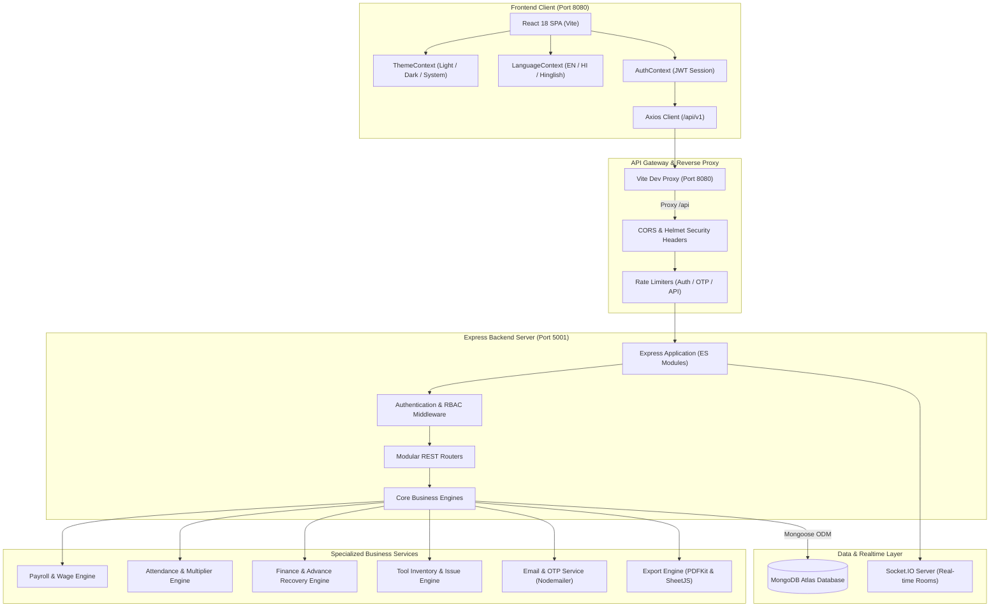
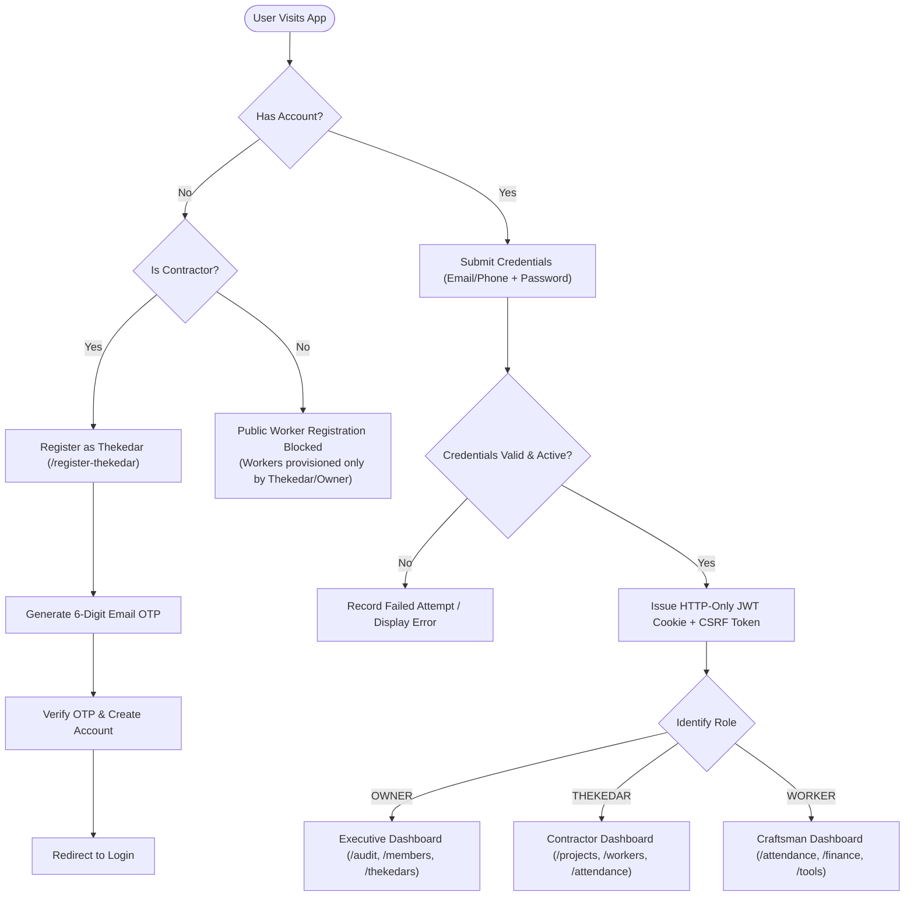
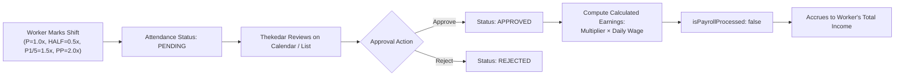
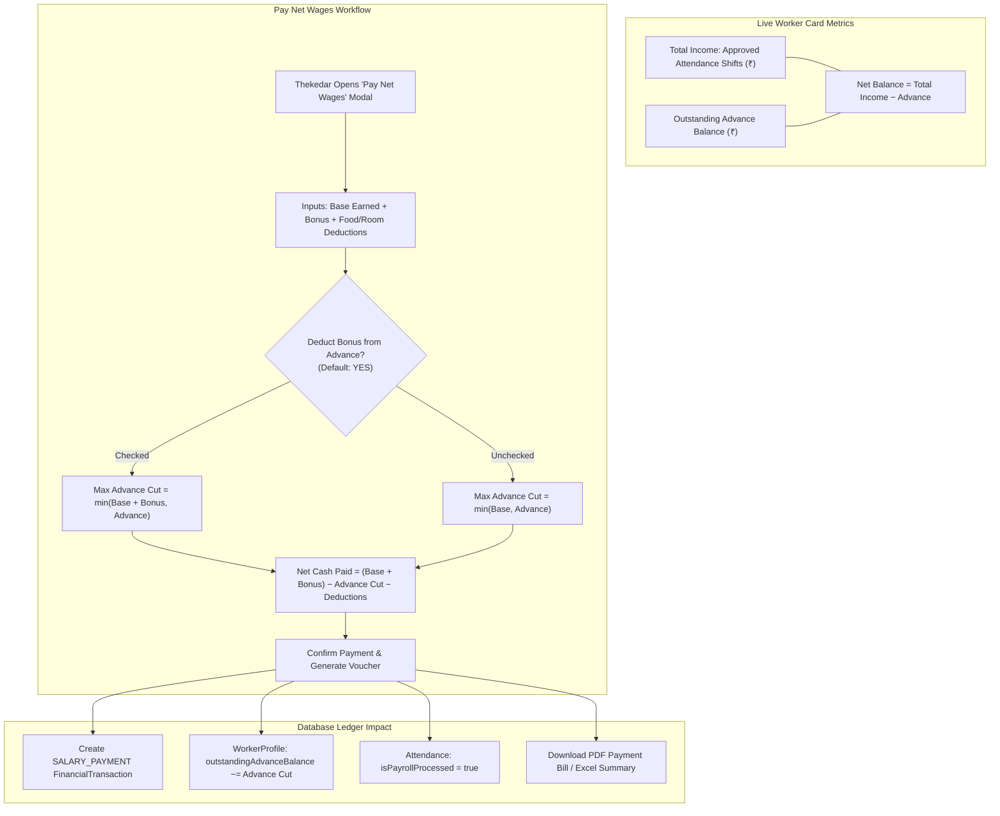
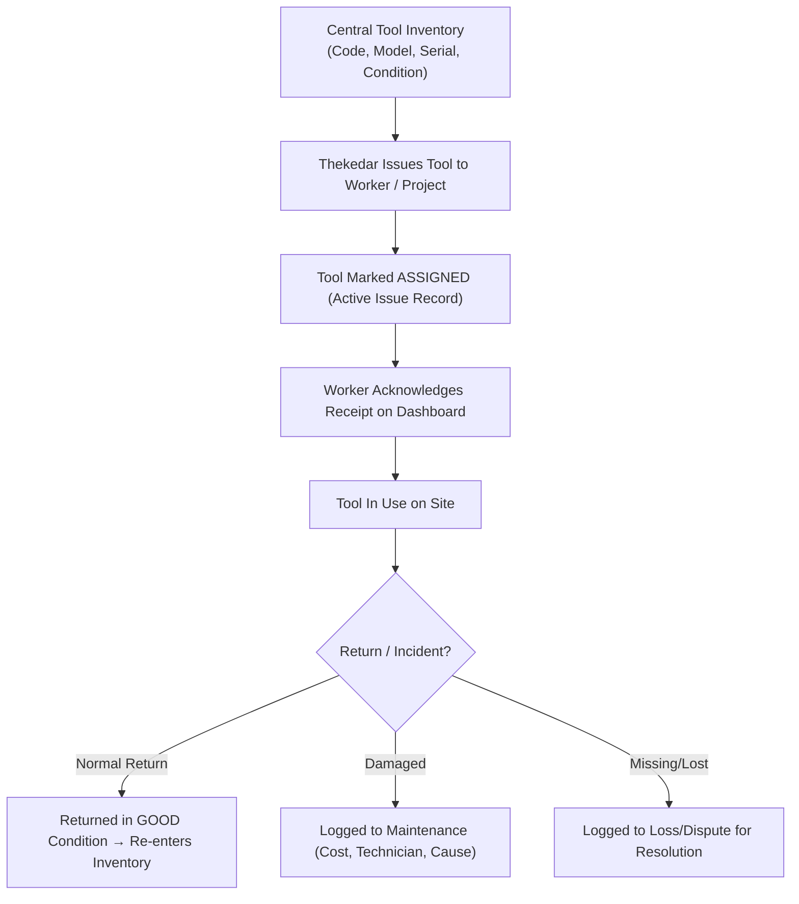

# FurniCraft — Modern Furniture Workforce & Financial Management ERP

[](https://nodejs.org/)
[](https://react.dev/)
[](https://vitejs.dev/)
[](https://tailwindcss.com/)
[](https://www.mongodb.com/)
[](https://vitest.dev/)
[](LICENSE)

**FurniCraft** is an enterprise-grade MERN-stack workforce, attendance, payroll, and workshop financial operations platform engineered exclusively for modern interior furniture manufacturing, cabinetry workshops, and modular installation businesses.

The application natively supports specialized interior carpentry craft scopes:
- **Modular Kitchens** (Base & wall carcasses, acrylic/PU finishes, tandem boxes, servo-drive drawers)
- **Sliding & Walk-in Wardrobes** (Top-hung tracks, aluminum profiles, soft-close dampers, sensor LED channels)
- **TV Units & Acoustic Paneling** (Fluted panels, veneer/laminate finishes, concealed cable conduits)
- **Workstations & Office Desking** (Raceway wiring, modular partitions, pedestal storage)
- **Beds, Headboards & Dressing Units** (Hydraulic storage beds, upholstered fluting, dresser mirrors)
- **Workshop Operations** (Edge-banding, panel-saw cutting, PU polishing, site assembly & hardware fittings)

---

## 1. System Architecture

The following diagram illustrates the end-to-end system architecture of FurniCraft, separating client delivery, security middleware, API services, and data layers:



---

## 2. Core Business Workflows & Flowcharts

### A. Authentication & Role-Based Access Control (RBAC)
FurniCraft enforces a strict 3-role governance model with protected workforce provisioning:



---

### B. Shift Attendance & Multiplier Calculation Lifecycle
Attendance accurately records daily work multipliers and calculates daily earned wages:

$$\text{Calculated Earnings} = \text{Wage Multiplier} \times \text{Default Daily Wage}$$



---

### C. Financial Balance & "Pay Net Wages" Settlement Engine
All financial balances strictly obey the golden accounting formula:

$$\text{Net Balance} = \text{Total Income (Approved Earnings)} - \text{Outstanding Advance Balance}$$

When paying net wages, contractors can deduct outstanding advances directly from both base earnings and bonuses:



---

### D. Tool Inventory & Maintenance Tracking Flow
Machinery and high-value tools (drills, routers, jigs, circular saws) are tracked across sites:



---

## 3. Technology Stack

### Frontend Architecture
| Technology | Version | Purpose |
| :--- | :--- | :--- |
| **React** | `v18.3.1` | Declarative component UI library |
| **Vite** | `v5.4.21` | High-speed frontend build tool & development server |
| **Tailwind CSS** | `v3.4.13` | Utility-first CSS framework with custom slatewood palette |
| **React Router** | `v6.26.2` | Client-side routing, protected routes, and layout hierarchies |
| **Lucide React** | `v0.446.0` | Modern SVG iconography |
| **FontAwesome** | `v6.5.2` | Industry-standard user & brand vector icons |
| **Axios** | `v1.7.7` | HTTP client with automatic language headers and response interceptors |
| **Socket.IO Client** | `v4.8.0` | Real-time WebSocket room subscriptions |
| **Vitest & RTL** | `v1.6.1` | Unit & integration testing with JSDOM environment |

### Backend Architecture
| Technology | Version | Purpose |
| :--- | :--- | :--- |
| **Node.js** | `v18+ / v24` | Modern asynchronous JavaScript runtime (ES Modules) |
| **Express.js** | `v4.21.0` | Web application framework for modular RESTful routing |
| **MongoDB & Mongoose** | `v8.6.3` | Cloud NoSQL database with schema validation & aggregations |
| **Zod** | `v3.23.8` | Strict runtime request schema validation |
| **JSON Web Token (JWT)**| `v9.0.2` | Stateless authentication tokens stored in HTTP-only cookies |
| **bcryptjs** | `v2.4.3` | Strong password hashing with salt rounds |
| **PDFKit** | `v0.15.0` | Server-side programmatic PDF payment voucher generation |
| **XLSX (SheetJS)** | `v0.18.5` | Exporting clean tabular attendance and ledger sheets |
| **Nodemailer** | `v6.9.15` | Automated OTP email delivery via transactional SMTP |
| **Helmet & Rate Limit**| `v7.1.0` | HTTP security headers and IP-based rate limiting |

---

## 4. Complete Project File Structure

```
FurniCraft/
├── package.json                         # Root package workspace scripts
├── .gitignore                           # Git exclusions (node_modules, .env, dist, logs)
├── README.md                            # Comprehensive system documentation
│
├── client/                              # Frontend React Single Page Application (Port 8080)
│   ├── index.html                       # HTML entry point with early theme bootstrap
│   ├── vite.config.js                   # Vite configuration (Port 8080, /api proxy to 5001)
│   ├── tailwind.config.js               # Tailwind CSS configuration with darkMode: 'class'
│   ├── postcss.config.js                # PostCSS autoprefixer plugins
│   ├── package.json                     # Client dependencies & scripts
│   ├── public/                          # Static brand icons & favicon assets
│   │   ├── furnicraft-logo.png          # Signature FC wood/blue monogram logo
│   │   ├── furnicraft-icon.svg          # Vector furniture monogram mark
│   │   └── favicon.ico                  # Browser tab icon
│   └── src/
│       ├── main.jsx                     # Application bootstrap & DOM root mounting
│       ├── App.jsx                      # Route definitions, ProtectedRoute guards & Layout
│       ├── index.css                    # Tailwind directives, custom scrollbars, dark theme rules
│       ├── api/
│       │   └── client.js                # Central Axios instance with credentials & interceptors
│       ├── context/
│       │   ├── AuthContext.jsx          # User login state, role helpers & logout handler
│       │   ├── LanguageContext.jsx      # Language state (en, hi, hinglish) & t() translation helper
│       │   └── ThemeContext.jsx         # Theme state (light, dark, system) & DOM class toggler
│       ├── locales/
│       │   └── translations.js          # Tri-lingual localization dictionaries (EN / HI / HINGLISH)
│       ├── components/
│       │   ├── common/                  # Reusable UI component library
│       │   │   ├── Badge.jsx            # Status indicators (Approved, Pending, Suspended)
│       │   │   ├── BrandLogo.jsx        # Responsive official FurniCraft emblem
│       │   │   ├── Button.jsx           # Accessible button with loading spinners & variants
│       │   │   ├── Card.jsx             # Themed content card container
│       │   │   ├── ErrorBoundary.jsx    # Graceful React crash fallback container
│       │   │   ├── LanguageSelector.jsx # Pill & button variants for language switching
│       │   │   ├── Modal.jsx            # Keyboard-accessible overlay dialog with ESC handling
│       │   │   └── ThemeSelector.jsx    # Light / Dark / System mode switch controls
│       │   ├── layout/                  # Shell layout components
│       │   │   ├── AppLayout.jsx        # Navigation shell (Navbar + Sidebar + Main Outlet)
│       │   │   ├── Navbar.jsx           # Top bar with mobile menu, BrandLogo & Profile Toggler
│       │   │   └── Sidebar.jsx          # Role-filtered sidebar navigation links & craft scope tag
│       │   └── attendance/
│       │       └── AttendanceCalendar.jsx # Interactive monthly grid with multiplier badges
│       ├── pages/                       # Dedicated application views
│       │   ├── LoginPage.jsx            # Sign in, demo credentials & Email OTP reset modal
│       │   ├── ThekedarRegisterPage.jsx # Public self-registration for contractors
│       │   ├── OwnerDashboard.jsx       # Executive high-level metrics & liabilities overview
│       │   ├── ThekedarDashboard.jsx    # Contractor daily operations & quick action center
│       │   ├── WorkerDashboard.jsx      # Craftsman shift records, salary ledger & tools
│       │   ├── ProjectsPage.jsx         # Furniture project list, milestones & creation
│       │   ├── ProjectDetailPage.jsx   # Project rooms, worker assignments & materials
│       │   ├── WorkersPage.jsx          # Worker directory, balances, pay net modal, safe delete
│       │   ├── WorkersPage.jsx          # Contractor workforce hub, attendance logging & wage payouts
│       │   ├── PayrollPage.jsx          # Monthly payroll generation, adjustments & lock
│       │   ├── FinancePage.jsx          # Cash advance disbursements, ledger transactions
│       │   ├── ToolsPage.jsx            # Central workshop machinery & tool tracking
│       │   ├── ExpensesPage.jsx         # Project money received & site material expenses
│       │   ├── TransactionSearchPage.jsx# Search transactions by code with voucher breakdown
│       │   ├── DisputesPage.jsx         # Grievances & transparent issue resolution
│       │   ├── AuditLogsPage.jsx        # Tamper-evident immutable system security logs
│       │   ├── MembersOverviewPage.jsx  # Organization roster & active workforce visits
│       │   └── ThekedarsPage.jsx        # Owner contractor oversight & account suspension
│       └── tests/                       # Vitest client test suites
│           ├── setup.js                 # JSDOM matchMedia mock & test configuration
│           ├── ThemeMode.test.jsx       # Dark/Light/System theme toggler tests
│           ├── LoginPage.test.jsx       # Authentication UI validation tests
│           ├── AttendanceCalendar.test.jsx # Shift multiplier rendering tests
│           └── AllPagesRender.test.jsx  # Comprehensive zero-blank-screen verification
│
└── server/                              # Backend Node.js / Express REST API (Port 5001)
    ├── package.json                     # Server scripts, dependencies & Vitest config
    ├── vitest.config.js                 # Server test runner configuration
    ├── .env.example                     # Environment configuration template
    ├── scratch/                         # Administrative maintenance scripts
    │   ├── fix_unpaid_attendance.js     # Synchronize processed attendance flags
    │   ├── reset_ramesh_test_payment.js # Reset test worker balance for clean verification
    │   └── test_list_workers.js         # Command-line ledger audit utility
    ├── tests/                           # Vitest server integration test suites
    │   ├── setup.js                     # Test database connection setup & teardown
    │   ├── auth.test.js                 # Authentication & token verification tests
    │   ├── auth_rules.test.js           # Password reset OTP lifecycle tests
    │   ├── authorization.test.js        # Strict RBAC & IDOR prevention tests
    │   ├── attendance.test.js           # Multiplier calculation & duplicate shift tests
    │   ├── finance.test.js              # Advance recovery & ledger transaction tests
    │   └── tools.test.js                # Machinery issue & assignment tests
    └── src/
        ├── server.js                    # HTTP server startup & Socket.IO initialization
        ├── app.js                       # Express app configuration, middleware & route mounting
        ├── config/
        │   ├── constants.js             # Enums: ROLES, SHIFTS, STATUS, CATEGORIES, CODES
        │   ├── db.js                    # Resilient MongoDB connection with DNS fallback
        │   └── env.js                   # Type-safe environment variable validation
        ├── middleware/
        │   ├── authMiddleware.js        # JWT token verification & role enforcement guards
        │   ├── errorHandler.js          # Centralized error formatter (CastError, ValidationError)
        │   ├── rateLimiter.js           # Sensitive endpoint brute-force protection
        │   ├── resourceAuthMiddleware.js# Resource-level access authorization (anti-IDOR)
        │   └── validationMiddleware.js  # Zod schema request body/query validation
        ├── models/                      # Mongoose Schema Definitions
        │   ├── index.js                 # Central model registry
        │   ├── User.js                  # User credentials, role, status & failed login tracking
        │   ├── WorkerProfile.js         # Daily wage, advance balance, skills, bank details
        │   ├── WageAgreement.js         # Historical & contractual daily wage agreements
        │   ├── Attendance.js            # Daily shifts, multiplier (1.0x, 0.5x, 1.5x, 2.0x), approval
        │   ├── AttendanceRuleVersion.js # Audit versioning for shift multiplier rules
        │   ├── Project.js               # Furniture project details, scope & deadlines
        │   ├── ProjectAssignment.js     # Worker-to-project allocations & custom wage rates
        │   ├── FinancialTransaction.js  # Immutable double-entry financial ledger records
        │   ├── AdvanceRequest.js        # Worker cash advance requests & approval states
        │   ├── Payroll.js               # Finalized monthly payroll sheets
        │   ├── PayrollAdjustment.js     # Post-finalization debit/credit adjustments
        │   ├── Tool.js                  # Machinery records, serial numbers, condition status
        │   ├── ToolIssue.js             # Active & historical tool assignment logs
        │   ├── ToolMaintenance.js       # Repair records, costs & servicing logs
        │   ├── ProjectExpense.js        # Hardware, laminates, fittings & site expenses
        │   ├── ProjectMoneyReceived.js  # Client milestone payment receipts
        │   ├── Dispute.js               # Worker grievances & resolution status
        │   ├── Notification.js          # In-app real-time notification alerts
        │   ├── OtpRecord.js             # Hashed 6-digit OTPs with expiration timestamps
        │   ├── RevokedToken.js          # Blacklisted JWTs upon logout
        │   └── AuditLog.js              # Tamper-evident security and activity audit trail
        ├── routes/                      # REST API Endpoint Routers
        │   ├── authRoutes.js            # /api/v1/auth (Login, Logout, Me, OTP Reset)
        │   ├── userRoutes.js            # /api/v1/users (Workers, Thekedars, Status changes)
        │   ├── projectRoutes.js         # /api/v1/projects (CRUD, assignments, milestones)
        │   ├── attendanceRoutes.js      # /api/v1/attendance (Mark, Approve, Bulk, Calendar)
        │   ├── payrollRoutes.js         # /api/v1/payroll (Preview, Finalize, Lock, Adjust)
        │   ├── financeRoutes.js         # /api/v1/finance (Ledger, Advances, Pay Net Wages)
        │   ├── toolRoutes.js            # /api/v1/tools (Inventory, Issue, Return, Maintenance)
        │   ├── furnitureTaskRoutes.js   # /api/v1/furniture-tasks (Assembly & installation jobs)
        │   ├── expenseRoutes.js         # /api/v1/expenses (Client payments & project costs)
        │   ├── reportRoutes.js          # /api/v1/reports (PDF vouchers, Excel attendance)
        │   ├── disputeRoutes.js         # /api/v1/disputes (Filing & administrative resolution)
        │   └── auditRoutes.js           # /api/v1/audit (Owner-only security audit log queries)
        ├── services/                    # Encapsulated Business Logic Services
        │   ├── authService.js           # Authentication, session tokens & OTP lifecycle
        │   ├── attendanceService.js     # Shift evaluation, earnings aggregation, calendar data
        │   ├── financeService.js        # Advance disbursements, net pay computation, ledger
        │   ├── payrollEngineService.js  # Monthly salary computation & immutable locking
        │   ├── projectService.js        # Furniture project lifecycle & contractor assignment
        │   ├── toolService.js           # Inventory checkouts, returns & condition updates
        │   ├── reportService.js         # Tabular data preparation for exports
        │   ├── exportService.js         # PDFKit payslip documents & Excel workbook formatting
        │   ├── emailService.js          # Transactional email dispatcher with Nodemailer
        │   ├── smsService.js            # SMS Gateway abstraction (Console, Fast2SMS, Twilio)
        │   └── auditService.js          # Asynchronous audit log persistence
        ├── utils/                       # Shared Helper Utilities
        │   ├── decimal.js               # Currency-safe floating point math utilities
        │   ├── errors.js                # Standardized AppError, NotFoundError, AuthError classes
        │   ├── jwt.js                   # JWT token generation & cookie signing helpers
        │   └── phone.js                 # Indian standard phone number normalization
        ├── validators/
        │   └── schemas.js               # Zod schemas for all inbound request validation
        └── scripts/
            ├── seed.js                  # Comprehensive database seeder with demo accounts
            ├── restore-test-fixtures.js # Fast test user reset script
            ├── create_owner_ranjit.js   # Standalone executive owner provisioning script
            └── cleanup_test_data.js     # Purge ephemeral test records after execution
```

---

## 5. User Roles & Permissions Matrix

FurniCraft has **exactly three user roles** (no ambiguous supervisor roles):

| Feature / Action | Owner / Admin | Thekedar (Contractor) | Worker (Craftsman) |
| :--- | :---: | :---: | :---: |
| **Self-Registration** | ❌ *(Configured)* | ✅ *(Email OTP Verified)* | ❌ *(Provisioned only)* |
| **View Organization Audit Logs** | ✅ *(Exclusive)* | ❌ | ❌ |
| **Suspend / Activate Contractor Accounts** | ✅ | ❌ | ❌ |
| **Suspend / Activate Worker Accounts** | ❌ *(Thekedar responsibility)* | ✅ *(Under their supervision)* | ❌ |
| **Create & Manage Furniture Projects** | 👁️ *(Read-Only)* | ✅ *(Full Management)* | 👁️ *(Assigned Only)* |
| **Register & Wage-Rate New Workers** | ✅ | ✅ | ❌ |
| **Mark Shift Attendance** | ❌ | ❌ | ✅ *(Personal shifts)* |
| **Approve / Reject Attendance Shifts** | ❌ | ✅ *(Single & Bulk)* | ❌ |
| **Request Cash / UPI Advance** | ❌ | ❌ | ✅ |
| **Disburse Advance & Pay Net Wages** | ❌ | ✅ | ❌ |
| **Deduct Advance Directly from Bonus** | ❌ | ✅ *(In Pay Net Modal)* | ❌ |
| **Delete Worker Account** | ❌ | ✅ *(ONLY if Net Balance = ₹0)* | ❌ |
| **Issue Machinery & Tools to Site** | ✅ | ✅ | ❌ |
| **Acknowledge Tool Receipt on Site** | ❌ | ❌ | ✅ |
| **Theme & Language Preference Toggle** | ✅ | ✅ | ✅ |

---

## 6. Configured Shift Multipliers & Wage Rules

FurniCraft implements the standard shopfloor wage conventions of the Indian modern furniture industry:

| Shift Code | Multiplier | Shift Description | Working Hours / Scope | Earned Formula |
| :---: | :---: | :--- | :--- | :--- |
| **`P`** | **1.0x** | Full Day Shift | Standard 8–9 hours work day | `1.0 × Daily Wage` |
| **`HALF`** | **0.5x** | Half Day Shift | 4 hours or half work day | `0.5 × Daily Wage` |
| **`P1/5`** | **1.5x** | Extended Evening Shift | Standard day + overtime until 9:00 PM | `1.5 × Daily Wage` |
| **`PP`** | **2.0x** | Double Shift / Night Stint | Standard day + intense work until Midnight | `2.0 × Daily Wage` |
| **`ABSENT`** | **0.0x** | Unexcused Absence | No attendance on scheduled work day | `₹0` |
| **`LEAVE`** | **0.0x** | Authorized Leave | Approved off-day or emergency leave | `₹0` |

---

## 7. Quick Start & Installation

### Prerequisites
- **Node.js**: v18.0.0 or later (v20+ recommended)
- **MongoDB**: Local MongoDB community server (port 27017) or MongoDB Atlas cluster URI
- **Package Manager**: npm (v9+) or pnpm / yarn

### Installation Steps

1. **Clone the Repository**
   ```bash
   git clone https://github.com/ranjit-sharma/FurniCraft.git
   cd FurniCraft
   ```

2. **Install Root, Server & Client Dependencies**
   ```bash
   # Install server dependencies
   cd server
   npm install

   # Install client dependencies
   cd ../client
   npm install
   ```

3. **Configure Environment Variables**
   Create `server/.env` based on `server/.env.example`:
   ```env
   NODE_ENV=development
   PORT=5001
   MONGODB_URI=mongodb+srv://<username>:<password>@cluster0.mongodb.net/furnicraft_db?retryWrites=true&w=majority
   JWT_SECRET=furnicraft_secure_jwt_secret_dev_key_must_be_long_and_robust_2026
   JWT_EXPIRES_IN=7d
   CLIENT_URL=http://localhost:8080
   COOKIE_DOMAIN=localhost

   # Transactional Email (Google App Password)
   EMAIL_SERVICE=gmail
   SMTP_USER=your_email@gmail.com
   SMTP_PASS=your_16_character_app_password
   EMAIL_FROM="FurniCraft ERP" <no-reply@furnicraft.com>
   ```

4. **Seed Database with Sample Data**
   ```bash
   cd server
   npm run seed
   ```

5. **Start Both Services**
   ```bash
   # Terminal 1 — Start Backend API (Port 5001):
   cd server
   npm run dev

   # Terminal 2 — Start Frontend Client (Port 8080):
   cd client
   npm run dev
   ```
   Open your browser at: **`http://localhost:8080`**

### Deploying to Render

FurniCraft is configured for zero-friction cloud deployment on [Render](https://render.com). It can be deployed in seconds as a single **Unified Web Service** (where Express serves both the REST API and the built React SPA):

1. **Create a New Web Service** on Render and connect `https://github.com/ranjit-sharma/FurniCraft.git`.
2. **Build & Start Commands** (Root defaults now work out of the box):
   - **Root Directory**: Leave blank (defaults to repository root `.`)
   - **Environment**: `Node`
   - **Build Command**: `npm install && npm run build` *(or `npm run build`)*
   - **Start Command**: `npm start`
3. **Environment Variables** (Under the "Environment" tab):
   - `NODE_ENV`: `production`
   - `MONGODB_URI`: `mongodb+srv://<username>:<password>@cluster0.mongodb.net/furnicraft_db?retryWrites=true&w=majority`
   - `JWT_SECRET`: Any random 32+ character secret string
   - `JWT_EXPIRES_IN`: `7d`
   - `PORT`: Leave blank (Render injects its own port automatically, typically `10000`)
4. **Click "Deploy Web Service"**:
   - The root build script installs both server and client packages, builds the client via Vite, and boots the backend with Express serving the React SPA and API on the same domain.
   - Alternatively, Render will automatically detect the included [`render.yaml`](file:///c:/Users/ranji/Desktop/project/FurniCraft/render.yaml) blueprint!

---

## 8. Safe Seed Demo Accounts

The seed script provides ready-to-test accounts representing all three operational roles:

| Role | Email / Login Identifier | Password | Name & Operational Scope |
| :--- | :--- | :--- | :--- |
| **Owner / Director** | `ranjitsharma7520@gmail.com`<br/>*(or `+91 98765 75200`)* | `ranjit@7520` | **Ranjit Sharma** (Executive Business Owner) |
| **Owner / Director** | `owner@furnicraft.com`<br/>*(or `+91 98765 43210`)* | `FurniOwner@2026` | **Vikramaditya Sharma** (Managing Director) |
| **Thekedar (Contractor)** | `thekedar.rajesh@furnicraft.com`<br/>*(or `+91 98111 22334`)* | `Thekedar@2026` | **Rajesh Thekedar** (Modular & Cabinetry Contractor) |
| **Worker (Master Craftsman)** | `worker.ramesh@furnicraft.com`<br/>*(or `+91 99222 33445`)* | `Worker@2026` | **Ramesh Carpenter** (Cabinet Maker, ₹800/day) |
| **Worker (Modular Specialist)**| `worker.suresh@furnicraft.com`<br/>*(or `+91 99333 44556`)* | `Worker@2026` | **Suresh Specialist** (Modular Assembly, ₹750/day) |

---

## 9. Automated Testing Suite

FurniCraft includes rigorous end-to-end integration and component test suites verifying RBAC, accounting formulas, shift multipliers, and zero-blank-screen rendering.

```bash
# Run all tests (Server + Client in parallel):
npm test

# Run Server Tests Only (Vitest + Supertest):
cd server
npm test

# Run Client Tests Only (Vitest + RTL + JSDOM):
cd client
npm test
```

### Server Integration Test Suites (`server/tests/`)
- **`auth.test.js`**: Session lifecycle, login credentials, token blacklist on logout, suspended user blocking.
- **`auth_rules.test.js`**: 6-digit email OTP generation, 5-minute expiration, attempt rate-limiting, secure password reset.
- **`authorization.test.js`**: In-depth RBAC, IDOR prevention, worker ledger isolation, read-only project limits for Owner, safe worker deletion ($₹0$ net balance enforcement).
- **`attendance.test.js`**: Precision multiplier calculations (`P`, `HALF`, `P1/5`, `PP`), single and bulk approval transitions, duplicate shift prevention.
- **`finance.test.js`**: Cash advance disbursement, wage settlement, bonus-to-advance offsets, immutable payment transactions.
- **`tools.test.js`**: Central tool inventory checkouts, active assignment conflicts, return condition logging.

### Client Component Test Suites (`client/src/tests/`)
- **`ThemeMode.test.jsx`**: Light, Dark (`#020617` slate), and System mode toggles, localStorage persistence, profile toggler dropdown verification.
- **`AttendanceCalendar.test.jsx`**: Shift badge rendering, multiplier tag colors, day-wise calculations.
- **`LoginPage.test.jsx`**: Responsive login form inputs, show/hide password toggle, contractor registration redirect.
- **`AllPagesRender.test.jsx`**: 12-page comprehensive zero-blank-screen smoke test across all application views.

---

## 10. Security & Data Integrity Highlights

1. **HTTP-Only Cookie Storage**: JWTs are stored in secure HTTP-only cookies (`furnicraft_token`). Tokens cannot be stolen via Cross-Site Scripting (XSS).
2. **Server-Side Authorization**: UI component hiding is never trusted as a security boundary. Every API endpoint checks actor identity and resource ownership (`resourceAuthMiddleware.js`).
3. **Double-Entry Financial Transactions**: Advance disbursements and salary payments create immutable `FinancialTransaction` records with unique transaction codes (e.g. `TXN-NET-2026-001`).
4. **Tamper-Evident Audit Logs**: All administrative actions (user suspensions, wage agreement revisions, project deletions, tool disposals) are logged asynchronously to the `AuditLog` collection.
5. **Safe Worker Deletion Guard**: A worker record cannot be deleted from the system while having unrecovered cash advances or unsettled earned wages. The net balance must be resolved to exactly ₹0.

---

## 11. Contributing & License

Contributions, issues, and feature requests are welcome. Feel free to open an issue or pull request on the repository.

Distributed under the **ISC License**. Designed and developed for the modern furniture manufacturing and craftsmen community.
